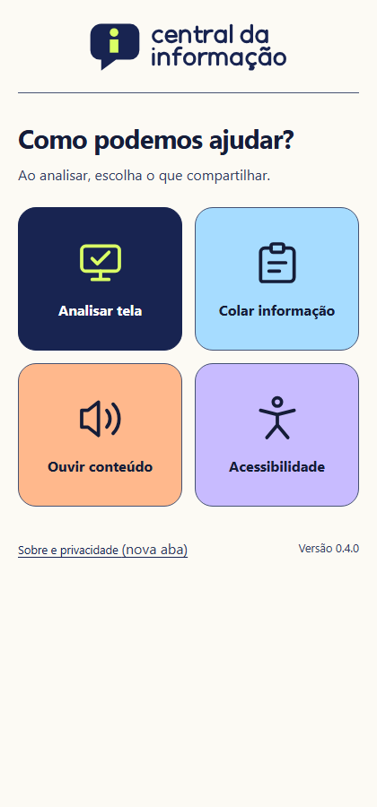
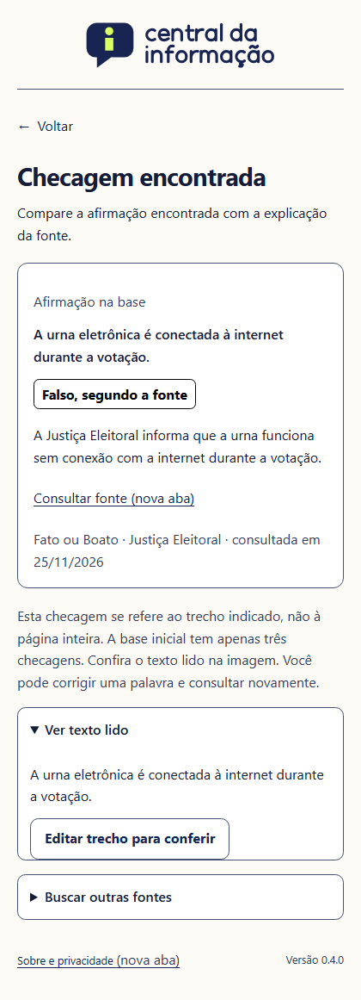

<p align="center"></p>

# Central da Informação

**Versão 0.4.0** · Extensão para Chrome de computador.

A Central da Informação ajuda a conferir mensagens eleitorais antes de compartilhá-las. Você escolhe uma aba, janela ou tela. A extensão captura uma imagem, encerra o compartilhamento e reconhece o texto em português no próprio dispositivo. Quando encontra uma das três afirmações da base, apresenta a checagem, a explicação e um link para a fonte.

<p> </p>

## Instalação da versão 0.4.0

1. Na [publicação da versão 0.4.0](https://github.com/Gabriel-Oliveira-Prado/Central-da-Informacao/releases/tag/v0.4.0), baixe `central-da-informacao-0.4.0.zip` e extraia o arquivo.
2. No Chrome 116 ou posterior, abra `chrome://extensions` e ative **Modo do desenvolvedor**.
3. Clique em **Carregar sem compactação** e selecione a pasta extraída que contém `manifest.json`. Se você clonou o repositório, selecione a pasta `extension`.
4. Fixe a extensão na barra do navegador. Abra uma página, clique no ícone da Central e confira a versão no rodapé do painel.

## Primeira consulta

Escolha **Colar informação** e cole a frase de teste “A urna eletrônica é conectada à internet durante a votação.” Clique em **Verificar informação**. O painel encontra a checagem, explica que a urna funciona desconectada durante a votação e oferece o link da Justiça Eleitoral.

Para usar **Analisar tela**, abra o conteúdo que deseja conferir, clique no card e confirme a área escolhida no seletor do navegador. Use **Ver texto lido** para conferir como as palavras foram reconhecidas. Em vídeos, a consulta considera apenas o quadro capturado. Mensagens de voz precisam de transcrição para consulta. **Sem conclusão** indica que a busca local não encontrou uma correspondência.

## Experimentar sem instalar

Requer Node.js 20 ou mais recente.

```sh
npm start
```

Abra http://127.0.0.1:4173/extension/panel.html no Chrome ou Edge de computador. Em **Analisar tela**, escolha uma aba, janela ou tela e confirme no seletor do navegador. Para experimentar, abra http://127.0.0.1:4173/demo/noticia.html em outra aba e escolha essa aba no seletor. O painel captura uma imagem sem áudio, encerra o compartilhamento e lê as palavras no dispositivo. Funciona também com texto visível em imagens e PDFs. A nitidez afeta a leitura.

## Os quatro cards

- **Analisar tela** reconhece o texto de uma imagem da área compartilhada e consulta até 8.000 caracteres nas três checagens locais. Abra **Ver texto lido** para conferir ou corrigir o trecho. Se a captura for bloqueada, o painel oferece a colagem e, na extensão, a leitura autorizada do texto da aba.
- **Colar informação** consulta a mesma base com texto digitado ou colado.
- **Ouvir conteúdo** lê o texto e a explicação, com pausa e parada. Sem texto anterior, solicita que você escolha uma tela na versão web ou permita ler a aba na extensão.
- **Acessibilidade** oferece tamanho de texto de 100% a 200%. O alto contraste vem ativado. Marque **Usar cores suaves** para trocar o tema.

Todos os cards são botões nativos com ícone decorativo e nome visível. Teclado, foco, zoom e mensagens de estado permanecem disponíveis. Texto completo e buscas adicionais ficam recolhidos por padrão na tela de resultado.

**A base é inicial e limitada.** O arquivo `extension/verification.js` contém três afirmações com explicação, fonte e data de consulta. A busca local exige frases completas correspondentes, ignorando caixa, acentuação e espaços; não faz inferência por palavras isoladas, não entende qualquer paráfrase e não usa um agente de IA. Negações diferentes da frase registrada ficam sem correspondência.

Quando há correspondência, o resultado exibe a conclusão da fonte sobre a afirmação registrada, inclusive se ela aparece citada em um texto. A página inteira não recebe um veredito. Para textos sem correspondência, mostra **Sem conclusão**. A base foi consultada em 25/11/2026 e não se atualiza automaticamente.

As três fontes iniciais são [urna e internet](https://www.justicaeleitoral.jus.br/fato-ou-boato/checagens/2026/fato-ou-boato-inteligencia-artificial-nao-pode-mudar-o-voto-do-eleitor-na-urna), [voto pela internet](https://www.justicaeleitoral.jus.br/fato-ou-boato/checagens/2026/e-falso-que-eleitores-possam-votar-on-line-pelo-celular-em-caso-de-chuva-no-brasil-votacao-e-sempre-presencial) e [celular na cabine](https://www.tse.jus.br/comunicacao/noticias/2026/Setembro/manual-do-eleitor-uso-de-celular-e-proibido-na-cabine-de-votacao). Isso ainda não constitui um serviço geral de checagem.

## Privacidade e permissões

O manifesto usa apenas `activeTab`, `scripting`, `storage` e `sidePanel`, sem acesso permanente a todos os sites, scripts executados automaticamente ou servidores de checagem. A política da extensão permite conexões apenas à própria origem, para carregar os arquivos de reconhecimento em `vendor/ocr`.

O texto fica na memória do painel; recarregá-lo apaga o conteúdo. Apenas os ajustes de leitura são armazenados localmente. A consulta à base é local e não envia o texto para checagem externa. Ao abrir uma busca adicional, o trecho visível no campo correspondente é enviado ao Google. Os links informam abertura de nova aba. Vozes podem usar serviços do navegador/sistema; vozes locais em português são priorizadas quando disponíveis.

A imagem pode conter qualquer dado visível na área escolhida. O fluxo alternativo que lê o documento da aba exclui campos de formulário e conteúdo oculto. Ambos mantêm o texto apenas na memória do painel.

O motor Tesseract.js, o worker, o núcleo WebAssembly e os dados de português acompanham a extensão. O reconhecimento dispensa servidor externo, conta e chave de IA. Os pacotes de origem estão fixados no arquivo de dependências. As licenças acompanham os arquivos em `extension/vendor/ocr`.

## Acessibilidade

ABNT NBR 17225:2025 e WCAG 2.2 orientam o desenvolvimento. Consulte [ACESSIBILIDADE.md](ACESSIBILIDADE.md) para o mapeamento, verificações e pendências. Não há declaração de conformidade integral ou certificação. A página **Como funciona e privacidade**, incluída na extensão, explica os limites em linguagem simples.

## Verificação técnica

```sh
npm ci
npx playwright install chromium
npm test
```

Os testes exercitam os quatro cards, teclado e retorno do foco, erros, contraste, ampliação, áudio simulado, cancelamento de capturas antigas ao navegar, exclusão de campos privados, ausência de envio automático, persistência mínima, correspondências conservadoras e captura real da extensão em um perfil isolado. A avaliação automática usa axe-core e não substitui leitores de tela nem testes com pessoas.

`npm start` não exige instalar pacotes. As dependências são apenas de desenvolvimento. Os ícones já estão incluídos; para regenerá-los, execute `node scripts/create-icons.mjs` com as dependências de desenvolvimento e o Chromium do Playwright instalados.

## Próxima etapa possível

Ampliar e manter a base de checagens ou conectar um serviço de busca com fonte, data e revisão humana. Um serviço de IA poderá ajudar a extrair afirmações ou localizar checagens; a conclusão precisará de evidências rastreáveis e opção de resultado inconclusivo. Nenhuma credencial deve ser colocada dentro de uma extensão distribuída.

## Referências

- [Ceweb.br — acessibilidade e ABNT NBR 17225](https://ceweb.br/acessibilidade/)
- [IFRS — apresentação da ABNT NBR 17225:2025](https://cta.ifrs.edu.br/abnt-nbr-17225-2025-acessibilidade-em-conteudo-e-aplicacoes-web-requisitos/)
- [W3C — WCAG 2.2](https://www.w3.org/TR/WCAG22/)
- [Chrome — acesso temporário à aba](https://developer.chrome.com/docs/extensions/develop/concepts/activeTab)
- [Chrome — painel lateral](https://developer.chrome.com/docs/extensions/reference/api/sidePanel)
- [Fato ou Boato](https://www.justicaeleitoral.jus.br/fato-ou-boato/)
- [Aos Fatos](https://www.aosfatos.org/)
