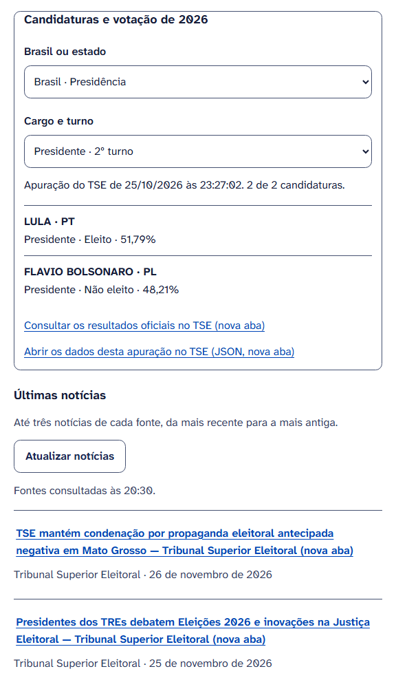

<p align="center"></p>

# Central da Informação

[Abrir o site da Central](https://tesselas-central-da-informacao.vercel.app) · [Instalar a extensão](https://tesselas-central-da-informacao.vercel.app/web/extensao.html)

**Versão 0.22.0** · Site para celular e computador e extensão para Chrome de computador.

A Central da Informação verifica notícias de qualquer tema. O resultado começa com **Verdadeiro** ou **Falso** e explica o que a fonte confirmou sobre a afirmação. Quando a evidência é insuficiente ou contraditória, aparece **Não verificado**. A Central acompanha a área de tela escolhida e reconhece texto e fala em português no dispositivo. A pesquisa consulta páginas online por assunto e usa a chave do servidor quando a comparação por Gemini está disponível.

<p align="center"> </p>

Veja Dora e Alex, os ajustes de acessibilidade, uma checagem por áudio em Eleições e a leitura da aba do Instagram na [demonstração narrada](docs/gravacoes/demonstracao.mp4). As [legendas em português](docs/gravacoes/demonstracao.vtt) também estão disponíveis no player do guia de instalação.

O áudio sobre levar celular à cabine recebeu **Verdadeiro**. A extensão reconheceu palavras e números na [publicação do Jornal do Commercio no Instagram](https://www.instagram.com/p/DeLGhWcjNlL/) e exibiu **Não verificado** para o trecho capturado. A postagem aberta apresentou imagem e legenda. A faixa de narração e o arquivo de voz usado na checagem são identificados pelas legendas do vídeo.

Se a notícia troca o ano de um vídeo real, o resultado explica qual ano aparece no trecho e qual foi confirmado pela fonte. Veja a comparação entre 2020 e 2025 na [gravação do site](docs/gravacoes/checagem-de-ano.webm) e na [gravação da análise de tela da extensão](docs/gravacoes/ano-na-analise-de-tela.webm).

## Equipe

Conheça no LinkedIn as pessoas que desenvolvem a Central da Informação.

- [Gabriel Oliveira Prado](https://www.linkedin.com/in/gabriel-oliveira-prado/)
- [Carlos Henrique](https://www.linkedin.com/in/carlos-henrique-12bb44351/)
- [Pedro Henrique Canto Bezerra](https://www.linkedin.com/in/pedro-henrique-canto-bezerra-5198682b7/)
- [Alyson Coutinho](https://www.linkedin.com/in/alyson-coutinho-b706442b3/)

## Executar o site

Com Node.js 22.19 ou posterior, execute `npm start` e abra o endereço impresso no terminal. A interface web funciona sem instalar a extensão. Compartilhamento de tela e áudio depende das opções oferecidas pelo navegador. Em celulares, os cards ficam empilhados e os campos e arquivos continuam disponíveis.

## Preparar a extensão

No início do site, **Como instalar e usar a extensão** abre o guia com o download do ZIP para Chrome, as instruções por teclado e o vídeo narrado. O mesmo guia inclui legendas em português. O botão **Sobre** ao lado do logotipo explica a Central sem interromper a sessão. Escape fecha a explicação e devolve o foco ao botão.

Execute `npm run build`. No Chrome, abra `chrome://extensions`, ative Modo do desenvolvedor e escolha Carregar sem compactação. Selecione a pasta `extensao` do projeto. O ícone abre o painel lateral. Ao executar `npm start`, essa preparação também acontece automaticamente.

## Organização

- `web/` contém a interface compartilhada, os recursos locais, a captura, os controles de áudio e o tradutor.
- `extensao/` contém o manifesto e o serviço do Chrome. O build acrescenta as pastas geradas `web/` e `regras-negocio/`, necessárias para carregar a extensão no navegador.
- `regras-negocio/` contém validação, checagens, pesquisa e fontes.
- `scripts/` contém o servidor local, a atualização editorial e o empacotamento.
- `tests/` contém testes de regras, navegação, mídia e fuzzing.
- `dist/site` e `dist/extensao` são gerados pelo mesmo código. Alterações devem ser feitas nos arquivos-fonte.

O site em atualização online usa o servidor de `npm start`. O pacote estático mantém a edição de notícias incluída quando as fontes online estão indisponíveis.

## Vozes em português do Brasil

A leitura começa com **Dora**. Em **Acessibilidade → Voz da leitura**, escolha **Alex** ou volte para **Dora**. Ao mudar, você ouve a apresentação na nova voz. A apresentação, o resumo do botão Sobre e os avisos frequentes acompanham o pacote e funcionam sem internet.

Para ler textos novos com Dora e Alex, quem hospeda a Central executa uma vez `python scripts/preparar-vozes.py` com Python 3.12 antes de iniciar o servidor Node. Esse comando prepara o ambiente isolado, baixa e verifica os pesos do modelo. O servidor gera o áudio em memória. Quem usa o site ou instala a extensão só precisa escolher a voz. Para uma implantação HTTPS, configure a origem da extensão durante o build conforme descrito abaixo.

Os timbres brasileiros usados são `pf_dora` e `pm_alex` do Kokoro-82M. O pacote inclui as frases sintetizadas. [Ficha das vozes](https://huggingface.co/hexgrad/Kokoro-82M/blob/main/VOICES.md) · [Modelo ONNX utilizado](https://github.com/thewh1teagle/kokoro-onnx/releases/tag/model-files-v1.0)

## Comparação de contexto com Gemini

O site e a extensão usam a mesma comparação. A pesquisa também procura o acontecimento sem a localização final. O servidor pede ao Gemini até duas consultas alternativas para localizar fontes. Depois envia a afirmação e parágrafos recuperados para comparação, inclusive quando já há uma checagem local. Para exibir um veredito da IA, a aplicação exige uma fonte identificada e confere se a citação está presente no texto recuperado. Sem chave ou sem cota, a pesquisa comum continua disponível.

Para desenvolver, crie uma chave no [Google AI Studio](https://aistudio.google.com/api-keys) e salve-a no arquivo local `.env` da raiz como `GEMINI_API_KEY=sua_chave`. Reinicie o servidor. O modelo padrão é `gemini-3.1-flash-lite`, substituível por `GEMINI_MODEL`. No PowerShell use `$env:PORT='4177'` antes de `npm start` para testar a extensão local.

Para distribuir, hospede o servidor Node por HTTPS com a chave em um segredo da hospedagem. Use `HOST=0.0.0.0` se a plataforma exigir e configure `PORT` conforme a plataforma. Defina `CENTRAL_PUBLIC_ORIGIN` com a origem HTTPS ao executar `npm run build` e distribua **dist/extensao**. O empacotador inclui somente a origem no manifesto. A pasta **extensao** da raiz aponta para o servidor de desenvolvimento. As pessoas usuárias acessam o site hospedado ou instalam o pacote da extensão sem configurar a API.

## Pesquisa online por assunto

A Central realiza uma busca a cada consulta, recupera publicações e lê passagens de páginas públicas. As perguntas novas não precisam ser cadastradas na base editorial. Os resultados são mantidos apenas durante a sessão. O endereço da matéria, sua data quando disponível e a redação da fonte ficam visíveis. Orientações gerais sobre voto distinguem a liberdade de escolha das condições da candidatura e da eleição. Uma semelhança temática oferece contexto, enquanto um veredito depende da afirmação checada.

O serviço de busca usa endpoints públicos de RSS, sujeitos a disponibilidade e alterações dos provedores. O site usa o servidor local como intermediário. A extensão acessa as origens declaradas no manifesto. Após trocar de versão, confirme as permissões solicitadas pelo navegador.

## Primeira consulta

Escolha **Colar informação** e cole a frase de teste “A urna eletrônica é conectada à internet durante a votação.” Clique em **Pesquisar informação**. O painel encontra a checagem, explica que a urna funciona desconectada durante a votação e oferece o link da Justiça Eleitoral.

No celular, abra **Analisar tela** e toque em **Escolher captura de tela** para pesquisar o texto de uma imagem da galeria. Nos navegadores que permitem compartilhar ao vivo, você também pode escolher a aba ou a tela. Para incluir voz, marque o áudio no seletor do navegador. O painel mostra o trecho e o contexto e oferece **Encerrar acompanhamento**. Na aba autorizada, um selo informa se a Central lê a tela e escuta áudio. Outras superfícies usam o indicador nativo do navegador.

Após a autorização, a Central analisa um trecho e mantém o resultado na tela. Use **Continuar análise** para apresentar mais conteúdo e **Encerrar acompanhamento** para consultar os resultados. Use Tab para chegar a um controle e Enter ou Espaço para acioná-lo. Ao iniciar ou continuar a análise, a voz anuncia a pesquisa. Quando o resultado chega, o aviso de voz tem prioridade enquanto você usa Tab. Ao encerrar, o foco vai para **Voltar**. Em **Acessibilidade**, desmarque **Ativar voz automática da Central** para silenciar a navegação e os avisos.

Experimente perguntar “Votar com 16 anos é só se quiser?”. A resposta explica a regra brasileira e apresenta a fonte do TSE. Perguntas abertas também podem receber uma resposta acompanhada de uma passagem da fonte.

## Experimentar sem instalar

Requer Node.js 22.19 ou mais recente.

```sh
npm start
```

Abra o endereço impresso por `npm start` no Chrome ou Edge de computador. Na porta padrão, o [site](http://127.0.0.1:4177/web/index.html) e a [aba de demonstração](http://127.0.0.1:4177/demo/acompanhamento.html) podem ser usados juntos. Compartilhe a aba de demonstração com a Central e reproduza o vídeo.

## Os cinco cards

- **Analisar tela** usa reconhecimento de texto, comparação com duas artes conhecidas e transcrição em português. O reconhecimento de objetos inicia automaticamente nos computadores que disponibilizam o modelo do Chrome. Ao encerrar, os trechos e suas fontes ficam na tela Resultados do acompanhamento. O navegador pode precisar baixá-lo.
- **Colar informação** recebe texto ou um link do UOL Notícias, Terra, g1, Agência Brasil, TSE, Justiça Eleitoral ou Aos Fatos. O card de arquivos aceita áudio, vídeo e legendas SRT ou VTT. Confira o texto reconhecido antes de verificar.
- **Ouvir conteúdo** recebe arquivo, microfone ou som da aba. No microfone, toque em Encerrar microfone e pesquisar ao terminar de falar. Você também pode dizer “abrir eleições”, “abrir acessibilidade”, “colar informação” ou “voltar ao início”. A leitura em voz alta tem velocidade ajustável, pausa e destaque aproximado das palavras conforme o áudio avança.
- **Acessibilidade** permite ampliar até 400%, escolher a distância entre letras e palavras, usar cores suaves, escolher paletas para protanopia, deuteranopia e tritanopia ou escala de cinza, ativar avisos falados e consultar o VLibras. A fonte Atkinson Hyperlegible Next acompanha a extensão.

- **Eleições** recebe perguntas, links, áudio, vídeo e legendas no mesmo formulário de checagem compartilhado. Mostra a apuração das eleições gerais de 2026 para a Presidência e as 27 UFs, por cargo e turno. Cada candidatura traz o percentual e a situação publicada pelo TSE. Os arquivos da edição acompanham o site e a extensão e podem ser renovados com `node scripts/atualizar-apuracao.mjs`. O painel também apresenta até três manchetes por fonte, com data e link. O painel consulta as listagens públicas do TSE e da Agência Brasil. Use **Atualizar notícias** para consultar essas duas origens. Sem conexão, a seleção incluída na versão continua disponível. Para renovar essa seleção antes de distribuir uma versão, execute `node scripts/atualizar-edicao.mjs` com as dependências e o Chromium do Playwright instalados.

<p></p>

Todos os cards são botões nativos com ícone decorativo e nome visível. Teclado, foco, zoom e mensagens de estado permanecem disponíveis. A revisão do texto, as buscas adicionais e a consulta pontual em Libras têm telas próprias. Os números 1 a 5 levam o foco ao card. Enter ou Espaço abre a opção selecionada. O botão de informação em cada card explica sua função. Ao navegar por Tab, a voz opcional lê o foco.

**Fontes de contexto.** A Central combina sete checagens editoriais com as publicações do g1 Fato ou Fake e da Agência Brasil. A atualização lê seus feeds públicos. Uma edição incluída funciona offline. Uma afirmação revisada ou correspondente ao enunciado de uma checagem explícita pode receber um veredito. Matérias relacionadas apresentam o contexto e o link da publicação.

Cada checagem inclui sua data de consulta. A edição de novembro de 2026 cobre voto pelo celular, conexão da urna, celular na cabine, identificação pelo e-Título, título impresso um vídeo de 2018 recirculado em 2022 e a regra da fila às 17h. As referências ficam em `regras-negocio/checagens.js`.

As três fontes iniciais são [urna e internet](https://www.justicaeleitoral.jus.br/fato-ou-boato/checagens/2026/fato-ou-boato-inteligencia-artificial-nao-pode-mudar-o-voto-do-eleitor-na-urna), [voto pela internet](https://www.justicaeleitoral.jus.br/fato-ou-boato/checagens/2026/e-falso-que-eleitores-possam-votar-on-line-pelo-celular-em-caso-de-chuva-no-brasil-votacao-e-sempre-presencial) e [celular na cabine](https://www.tse.jus.br/comunicacao/noticias/2026/Setembro/manual-do-eleitor-uso-de-celular-e-proibido-na-cabine-de-votacao). A cobertura depende da afirmação e das fontes encontradas. Notícias relacionadas não comprovam a informação.

## Libras

Em Acessibilidade, marque **Ativar Libras em todas as telas** para usar o widget no site e na extensão. O ajuste fica salvo. A tradução precisa de conexão e envia ao VLibras o texto selecionado. Em um resultado, a consulta pontual também permanece disponível. Na versão web, o botão **Ativar VLibras nesta página** carrega o widget oficial em uma página separada. Na extensão instalada, o link abre a ferramenta hospedada pelo VLibras. A consulta inicia quando a pessoa escolhe o texto no serviço.

O VLibras é gratuito. A API comercial Hand Talk for Devs requer uma chave contratada. A página de planos do plugin para sites anuncia tradução em Libras a partir do plano Light. [VLibras](https://www.gov.br/governodigital/pt-br/acessibilidade-e-usuario/vlibras) · [Configuração do SDK Hand Talk](https://api-docs.handtalk.me/v1/javascript/reference/explain-configs) · [Planos do plugin Hand Talk](https://www.handtalk.me/br/planos/)

## Privacidade e permissões

O manifesto autoriza consultas ao servidor da Central, UOL Notícias, Terra, Bing, Google Notícias, g1, Agência Brasil, TSE, Justiça Eleitoral, Aos Fatos e Planalto. Não solicita acesso permanente a todos os sites. O seletor de tela e o microfone exigem autorização do navegador. A transcrição usa o Vosk local e o modelo de português incluído. A pesquisa por assunto envia um trecho de texto ou fala aos buscadores e portais consultados. Imagens e arquivos permanecem no dispositivo. As perguntas e os resultados da pesquisa ficam na memória da sessão.

O texto fica na memória do painel; recarregá-lo apaga o conteúdo. Apenas os ajustes de leitura são armazenados localmente. A comparação editorial é local. A pesquisa online transmite a consulta aos provedores indicados na interface. Ao abrir uma busca adicional, o trecho visível no campo correspondente é enviado ao Google. Os links informam abertura de nova aba. A geração de falas novas com Dora ou Alex envia o texto ao servidor da Central.

A imagem pode conter qualquer dado visível na área escolhida. O fluxo alternativo que lê o documento da aba exclui campos de formulário e conteúdo oculto. Ambos mantêm o texto apenas na memória do painel.

O motor Tesseract.js, o worker, o núcleo WebAssembly e os dados de português acompanham a extensão. O reconhecimento dispensa servidor externo, conta e chave de IA. Os pacotes de origem estão fixados no arquivo de dependências. As licenças acompanham os arquivos em `web/vendor/ocr`.

## Acessibilidade

ABNT NBR 17225:2025 e WCAG 2.2 orientam o desenvolvimento. Consulte [ACESSIBILIDADE.md](ACESSIBILIDADE.md) para o mapeamento, verificações e pendências. Não há declaração de conformidade integral ou certificação. A página **Como funciona e privacidade**, incluída na extensão, explica os limites em linguagem simples.

## Verificação técnica

```sh
npm ci
npx playwright install chromium
npm test
```

Os testes exercitam os cinco cards, teclado e retorno do foco, erros, contraste, ampliação, áudio simulado, cancelamento de capturas antigas ao navegar, exclusão de campos privados, persistência mínima, pesquisa online, correspondências conservadoras e captura real da extensão em um perfil isolado. A avaliação automática usa axe-core e não substitui leitores de tela nem testes com pessoas.

`npm start` não exige instalar pacotes. As dependências são apenas de desenvolvimento. Os ícones já estão incluídos; para regenerá-los, execute `node scripts/gerar-icones.mjs` com as dependências de desenvolvimento e o Chromium do Playwright instalados.

## Referências

- [Ceweb.br — acessibilidade e ABNT NBR 17225](https://ceweb.br/acessibilidade/)
- [IFRS — apresentação da ABNT NBR 17225:2025](https://cta.ifrs.edu.br/abnt-nbr-17225-2025-acessibilidade-em-conteudo-e-aplicacoes-web-requisitos/)
- [W3C — WCAG 2.2](https://www.w3.org/TR/WCAG22/)
- [Chrome — acesso temporário à aba](https://developer.chrome.com/docs/extensions/develop/concepts/activeTab)
- [Chrome — painel lateral](https://developer.chrome.com/docs/extensions/reference/api/sidePanel)
- [Fato ou Boato](https://www.justicaeleitoral.jus.br/fato-ou-boato/)
- [Aos Fatos](https://www.aosfatos.org/)


## Ensaios com mídia externa

O comando `node scripts/testar-midias-reais.mjs` obtém dois vídeos públicos do Wikimedia Commons, com fonte e licença, e envia os arquivos completos pelo campo da aplicação. Execute com o site aberto. Para outra porta, defina `TEST_URL`. Os resultados e as amostras ficam em `dist/ensaios-reais`, fora do versionamento. O ensaio registra a resposta observada, inclusive transcrição incorreta e ausência de evidência. Ele não define um veredito pela aparência do arquivo.

Consulte os resultados e os limites em [Validação da versão 0.10.0](docs/validacao-0.10.0.md).

## Gravar a validação

Com o servidor em execução, use `node scripts/gravar-validacao.mjs`. A porta padrão deste roteiro é 4177; ajuste `TEST_URL` se necessário. O roteiro prepara quatro extensões oficiais de validação em `dist/ferramentas` e usa apenas perfis isolados do Chromium. Não instala extensões no seu perfil pessoal. Lighthouse e axe-core acompanham as dependências de desenvolvimento.

Os vídeos WebM, capturas, relatórios e a galeria acessível ficam em `dist/validacao-0.11.0`. AMAWeb recebe uma cópia do HTML renderizado pelo campo de código. Essa avaliação cobre o estado enviado. Uma recusa do serviço é registrada como bloqueio, sem atribuir nota. Consulte [Validação 0.11.0](docs/validacao-0.11.0.md).
